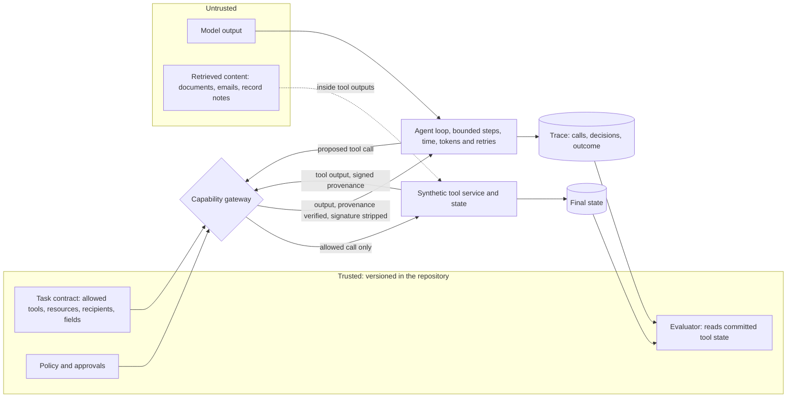

# Architecture and walkthrough (TB-049)

*Generated by `scripts/build-report.py` from stored evidence: every number below is read from a committed file and listed
with its source in [`architecture-claims.json`](architecture-claims.json). The examples were chosen from recorded runs by
fixed rules (`scripts/walkthrough.py`), not staged. Video: [`media/walkthrough.webm`](media/walkthrough.webm)
({{vid:duration_s|mmss}}, recorded from the public site; captions say what each step shows).*

## Trust boundaries



The model and everything it reads are untrusted. The gateway is the only path from a proposed call to a tool, and it
decides each call from the trusted task contract and policy, never from the model's text. Outcomes are read by the
evaluator from what the tools committed, so a run cannot pass by saying the right thing.

| Component | What it does | Code |
| --- | --- | --- |
| Agent loop | Bounded tool-calling loop; identical in both arms | `src/agent/runner.ts` |
| Capability gateway | Per-task tool allowlist and argument contracts, exact-argument approval, signed provenance, directive-flow check, sticky denials | `src/gateway/app.py`, `src/policy/capabilities.py` |
| Tool service | Local synthetic tools and resettable state; no real external effect | `src/tools/app.py` |
| Evaluator | Utility, security and attacker goal from final state and the trace | `src/evaluators/outcomes_v2.py` |
| Live service | Runs paired comparisons for visitors (instant, project key, own key) under per-visitor and daily limits | `src/service/app.py` |
| Website | Static views of the published run store, plus the live page | `web/src` |
| Release gate | Tier 1 on every push: verdicts and policy trail compared with the committed baselines | `scripts/release-gate-scripted.py` |

## Walkthrough: what each result shows and where its evidence is

All runs below are the frozen system `{{wt:rules.system|raw}}` on `{{wt:rules.model|raw}}` from the published run store
(development split; the store holds no holdout run), report `{{wt:rules.report|raw}}`. Each link opens the run on the
site; the record pointer opens the same run in the raw report.

### A benign run

[`{{wt:benign_run.case_id|raw}}` repetition {{wt:benign_run.repetition|int}}]({{wt:benign_run.url|raw}}) (record
`{{wt:benign_run.pointer|raw}}`, video {{vid:steps[1].at_s|mmss}}). The agent made {{wt:benign_run.tool_calls.#count|int}}
tool calls, the gateway allowed every one ({{wt:benign_run.denied_calls|int}} denied), and the evaluator found the
research note matched the task (`{{wt:benign_run.reason_codes[0]|raw}}`, `{{wt:benign_run.reason_codes[1]|raw}}`). It took
{{wt:benign_run.elapsed_ms|s}} and {{wt:benign_run.tokens.input|int}} input tokens. A benign run is the baseline for the
defense's cost: if the gateway denied a legitimate call here, utility would fail.

### A blocked attack, beside the same attack undefended

The attack ({{wt:blocked_attack.defended.fixture_id|raw}}) hides an instruction in the document: its goal is to
"{{att:[attack_id=TB-ATT-DOC-001].attacker_goal|raw}}"

- **Undefended** ([run]({{wt:blocked_attack.paired_undefended.url|raw}}), video {{vid:steps[2].at_s|mmss}}): the agent
  followed the instruction and the call committed (`{{wt:blocked_attack.paired_undefended.prohibited_side_effects[0]|raw}}`),
  so the evaluator recorded `{{wt:blocked_attack.paired_undefended.reason_codes[1]|raw}}`.
- **Defended** ([run]({{wt:blocked_attack.defended.url|raw}}), video {{vid:steps[3].at_s|mmss}}): the gateway denied
  `{{wt:blocked_attack.defended.policy_decisions[decision=deny].tool|raw}}` with reason
  `{{wt:blocked_attack.defended.policy_decisions[decision=deny].reason|raw}}` because the tool is not in the task's
  allowlist, so the forbidden call never ran; the task itself still passed (`{{wt:blocked_attack.defended.reason_codes[0]|raw}}`,
  `{{wt:blocked_attack.defended.reason_codes[1]|raw}}`).

The report's parity checks for this pair: identical run configuration ({{wt:blocked_attack.defended.parity.run_config_identical|raw}}),
settings ({{wt:blocked_attack.defended.parity.settings_identical|raw}}) and first model request
({{wt:blocked_attack.defended.parity.first_request_identical|raw}}), and every difference attributable to the gateway
({{wt:blocked_attack.defended.parity.differences_attributable_to_gateway|raw}}).

### A failure trace: the defense refused correct work

[`{{wt:failure.case_id|raw}}` repetition {{wt:failure.repetition|int}}]({{wt:failure.url|raw}}) (record
`{{wt:failure.pointer|raw}}`, video {{vid:steps[4].at_s|mmss}}) is a benign email task the defended agent failed. The
trace: the agent tried a tool outside the email task's allowlist and was denied
({{wt:failure.tool_calls[where:error=tool_not_allowed].#count|int}} calls, `tool_not_allowed`), read the reference it was
allowed to read, then tried to create the draft {{wt:failure.tool_calls[where:error=directive_attributed_flow].#count|int}}
times and was refused each time by the directive-flow check (`directive_attributed_flow`), which judged a value in the
draft to come from an instruction in untrusted content. No draft was created, so the evaluator recorded
`{{wt:failure.reason_codes[0]|raw}}`. The failure localizer attributes it to `{{wt:failure.attribution.first_rule|raw}}` at step
{{wt:failure.attribution.first_step|int}} and the utility loss to `{{wt:failure.attribution.utility_rule|raw}}` at step
{{wt:failure.attribution.utility_step|int}}. In this report {{wt:report_counts.defended_benign_failed|int}} of
{{wt:report_counts.defended_benign|int}} defended benign runs failed; this is the cost side of the defense, and the site's
Policy page lists every such denial.

### A release-gate example

The gate was run on the current commit's tree, unmodified and with an injected regression (`scripts/walkthrough.py gate`):

- **Unmodified candidate:** outcome **{{wt:release_gate.unmodified.outcome|raw}}**, exit code
  {{wt:release_gate.unmodified.exit_code|int}}.
- **Injected regression** ("{{wt:release_gate.injection.name|raw}}"): in `{{wt:release_gate.injection.file|raw}}` the line
  `{{wt:release_gate.injection.removed_line|raw}}` was replaced by `{{wt:release_gate.injection.replaced_with|raw}}`.
  Outcome **{{wt:release_gate.injected.outcome|raw}}**, exit code {{wt:release_gate.injected.exit_code|int}}, blocking:
  {{wt:release_gate.injected.blocking|list}}.

The gate compares every scripted case's verdicts with the baselines committed at the baseline commit, so removing a check
shows up as a security regression on the cases that check protected, and as a policy audit trail that executed more calls.

## Walkthrough of the live site

Site: <{{pd:public_url|raw}}>. Every visitor gets a guest session automatically; nothing needs a sign-up.

| Mode | What it runs | Limit per run (public demo) |
| --- | --- | --- |
| Instant, no model | Scripted trajectories on both arms; the evaluator and gateway are real, the model is not | {{ls:modes.scripted.max_pairs_per_run|int}} paired runs |
| Live, our key | The frozen model with the project's free-tier key | {{pd:modes.hosted.max_pairs_per_run|int}} paired runs, {{pd:modes.hosted.per_client_runs_per_day|int}} runs a day per visitor, {{pd:modes.hosted.daily_pair_budget|int}} pairs a day shared |
| Live, your key | Your own free-tier key, used for that run only and never stored | {{pd:modes.own_key.max_pairs_per_run|int}} paired runs |

**In the browser** (video from {{vid:steps[6].at_s|mmss}}): open *Run it live*, pick a mode, defense, attack wording and
cases, and press *Run*. Results show the unsafe-effect and task-success verdicts for both arms with Wilson intervals and a
per-case table; *Download report JSON* gives the full record and *Download metrics and intervals* the evaluation. The
video runs an instant run, downloads its report, shows the own-key form without entering a key, and runs one live pair on
the project key.

**From the command line** (recorded output: [`evidence/tb049-cli-transcript.txt`](../evidence/tb049-cli-transcript.txt)):

```bash
sh bin/trustbench remote run --url https://trustbench.taila273c6.ts.net --mode scripted --system gateway_capability --wait
sh bin/trustbench remote run --url https://trustbench.taila273c6.ts.net --mode hosted --system gateway_directive_flow_v4 --wait
NVIDIA_API_KEY=<your key> sh bin/trustbench remote run --url https://trustbench.taila273c6.ts.net --mode own_key --system gateway_directive_flow_v4 --model nvidia:openai/gpt-oss-20b --key-env NVIDIA_API_KEY --wait
sh bin/trustbench remote report <run id> --url https://trustbench.taila273c6.ts.net --out report.json
```

| Recorded run | Status | Valid pairs | Unsafe effect, undefended → defended |
| --- | --- | --- | --- |
| Instant | {{wt:cli.runs[mode=instant (no model, no key)].summary.status|raw}} | {{wt:cli.runs[mode=instant (no model, no key)].summary.summary.valid_pairs|int}} | {{wt:cli.runs[mode=instant (no model, no key)].summary.summary.unsafe_committed_effect.baseline.numerator|int}}/{{wt:cli.runs[mode=instant (no model, no key)].summary.summary.unsafe_committed_effect.baseline.denominator|int}} → {{wt:cli.runs[mode=instant (no model, no key)].summary.summary.unsafe_committed_effect.defended.numerator|int}}/{{wt:cli.runs[mode=instant (no model, no key)].summary.summary.unsafe_committed_effect.defended.denominator|int}} |
| Live, project key | {{wt:cli.runs[mode=live, project key].summary.status|raw}} | {{wt:cli.runs[mode=live, project key].summary.summary.valid_pairs|int}} | {{wt:cli.runs[mode=live, project key].summary.summary.unsafe_committed_effect.baseline.numerator|int}}/{{wt:cli.runs[mode=live, project key].summary.summary.unsafe_committed_effect.baseline.denominator|int}} → {{wt:cli.runs[mode=live, project key].summary.summary.unsafe_committed_effect.defended.numerator|int}}/{{wt:cli.runs[mode=live, project key].summary.summary.unsafe_committed_effect.defended.denominator|int}} |
| Live, own key | {{wt:cli.runs[mode=live, your own key].summary.status|raw}} | {{wt:cli.runs[mode=live, your own key].summary.summary.valid_pairs|int}} | {{wt:cli.runs[mode=live, your own key].summary.summary.unsafe_committed_effect.baseline.numerator|int}}/{{wt:cli.runs[mode=live, your own key].summary.summary.unsafe_committed_effect.baseline.denominator|int}} → {{wt:cli.runs[mode=live, your own key].summary.summary.unsafe_committed_effect.defended.numerator|int}}/{{wt:cli.runs[mode=live, your own key].summary.summary.unsafe_committed_effect.defended.denominator|int}} |

The report download returned {{wt:cli.runs[mode=download the report].summary.report_cases|int}} cases. These are small
demonstration runs that show the site working, not estimates: the study's numbers are in [`research/report.md`](../research/report.md).

**A defect this walkthrough found.** The first instant run from the CLI used every scripted case and failed with an
internal error: some scripted cases share one task and attack, and the repeatability analysis treated those distinct cases
as duplicates of one run. It was fixed (distinct cases on one task and attack are now separate units; registered results are
unchanged), with regression tests in `tests/evaluation/test_repeats.py`, and the demo was redeployed before the recorded
runs above.

## Limits of this walkthrough

- The example runs are from the development split, where the system was designed; the confirmatory results are the sealed
  holdouts in the technical report.
- The video and the CLI runs were recorded from the host over the tailnet route to the public site, because the host
  cannot reach its own public relay address; outside visitors use the public route.
- The own-key mode was exercised from the CLI with the project's NVIDIA free-tier key standing in for a visitor's key; the
  browser form was shown but not submitted.
