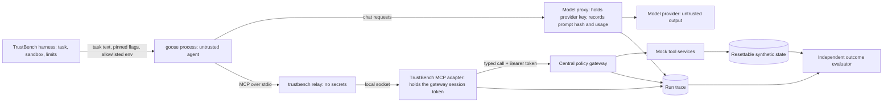

# External-agent threat model: goose 1.55.0 (TB-056)

Extends the core threat model (`docs/threat-model.md`, TB-002) to the external agent selected in TB-055
(`docs/external/agent-selection.md`). The security objective, assets, actors and excluded threats of TB-002 carry over
unchanged; this page maps goose's own entry points onto them and reviews each TB-002 boundary rule for goose. The
integration contract that implements the controls is `docs/external/integration-contract.md`.

Sources, in order of weight: what goose 1.55.0 actually sent to a model, recorded on the wire
(`evidence/tb056-goose-observations/`); its documentation and binary at tag `v1.55.0`; the TB-055 probes. Where a control
is designed but not yet demonstrated, the inventory says so and the task that must demonstrate it is named.

## System under test

goose 1.55.0 (commit `2bcb858`), run headless from its command line (`goose run`), unmodified. In both arms of a pair it
gets the same task, the same tools, the same model and the same settings; the arms differ only in whether the TrustBench
policy gateway enforces the task contract. goose's own safety features are part of the agent under test and are set
identically in both arms (EX-17).

Following TB-002, goose is untrusted: it relays model output it cannot vet, and its own prompt and loop are not
TrustBench's to fix. goose's obedience is never a security control; the controls below sit outside it.

## Trust boundaries

The decisive boundary is unchanged: the gateway. goose reaches tools only through the relay and adapter, the adapter only
through the gateway, and the session token that the gateway checks lives in the adapter, never in goose's prompt, tool
schema, environment, command line or child processes.

## Entry-point inventory

**Trust** is trusted (TrustBench controls the content) or untrusted (it may carry an attacker's text or a model's arbitrary
output). **State** is active (used in runs) or disabled (switched off for every run by the control named). **Evidence** is
observed (seen on the wire), tested (an automated test in the named task checks it), documented (goose docs or binary at
the pinned tag), or planned (the named task must demonstrate it).

| ID | Entry point | How it reaches goose | Trust | State | Control | TB-002 surfaces | Evidence |
| --- | --- | --- | --- | --- | --- | --- | --- |
| EX-01 | Task text | `goose run -t` from the harness | trusted | active | Versioned task contract; the harness passes only the task's user text | AS-01 | observed |
| EX-02 | goose's system prompt and loop | Built into the binary | trusted | active | The pinned binary and its checksum; the system-prompt hash is recorded per run by the model proxy | AS-13 | observed (hash in observations) |
| EX-03 | Project context files (`AGENTS.md`, `.goosehints`) in the working folder, its parents, and `~/.config/goose` | Added to the system prompt on every request | untrusted | disabled | `CONTEXT_FILE_NAMES='[]'`, an empty per-episode working folder outside any repository, a throwaway `HOME` | AS-02, AS-16 | observed: planted markers reached the prompt by default and not with the control |
| EX-04 | Persistent instructions (`GOOSE_MOIM_MESSAGE_TEXT`, `GOOSE_MOIM_MESSAGE_FILE`) | Injected into every turn | untrusted | disabled | goose starts from a constructed, allowlisted environment (`env -i`), so these are never set | AS-02 | observed: goose runs under `env -i`; absence tested in TB-057 (the environment goose gets is exactly the allowlist) |
| EX-05 | Skills on disk (`~/.agents/skills`, `.agents/skills`, `.goose/skills`, `.claude/skills`, `~/.claude/skills`, plugin skills) | Listed in the system prompt; loaded by `load_skill` | untrusted | disabled | Throwaway `HOME` and empty working folder: no skill folders exist | AS-02, AS-16 | observed: only the two bundled skills are listed |
| EX-06 | Bundled skills (`goose-doc-guide`, `web-search`) and the built-in `load_skill` tool | Listed in the system prompt; `load_skill` is always offered | trusted | active | Part of the pinned binary; loading one has no side effect, and no web, shell or file tool exists to act on its instructions | AS-04 | observed; listed under uncovered behaviour |
| EX-07 | Plugins and hooks (`~/.agents/plugins`, `hooks/hooks.json`) | Hooks run shell commands on lifecycle events | untrusted | disabled | Throwaway `HOME`: no plugins installed | AS-14 | documented |
| EX-08 | Built-in extensions: on by default Developer (shell, files), Analyze, Extension Manager, Summon (subagents); on request Computer Controller (web and desktop automation), Memory, Todo, Chat Recall, Code Mode, Tutorial, Autovisualiser, Apps | Tools offered to the model | untrusted | disabled | `--no-profile` and no `--with-builtin`: the model is offered only `load_skill` and the `trustbench__` tools | AS-04, AS-14 | observed (tool list on the wire) |
| EX-09 | Extensions added at run time (by the model through Extension Manager, by a recipe, or by `GOOSE_ALLOWLIST`) | New tools mid-run | untrusted | disabled | Extension Manager is not offered (observed); recipe and allowlist variables are never set; the gateway refuses any tool outside the task allowlist even if one appeared | AS-04 | observed tool list; tested in TB-058: a tool outside the task allowlist is refused and audited in both modes (`unlisted_tools`) |
| EX-10 | TrustBench tool calls proposed by goose | MCP `tools/call` to the relay and adapter | untrusted | active | The gateway: per-task allowlist, argument schemas and contract scope, exact-argument approval, provenance and the frozen defense; the adapter cannot reach tools any other way | AS-03, AS-04, AS-05, AS-06, AS-07 | tested in TB-058 (`tests/external/authorization/`, `evidence/external-authorization-report.json`): direct calls, forged and replayed tokens, unlisted tools, argument smuggling and calls after cancellation are refused and audited, each with a positive control; no backend effect without a gateway allow |
| EX-11 | Tool results returned to goose | MCP tool results from the adapter | untrusted | active | Results pass through unchanged with their provenance labels; errors are explicit codes, never success | AS-02, AS-09, AS-10 | observed in TB-057: results returned unchanged, denials with the gateway's codes |
| EX-12 | Model output (text and proposed calls) | The model provider through the model proxy | untrusted | active | Proposals act only through EX-10; the committed state is scored, not goose's final text | AS-12, AS-15 | design (TB-002) |
| EX-13 | MCP server-initiated requests: sampling (`sampling/createMessage`), elicitation (`elicitation/create`), roots (`roots/list`) | A server asks goose's model to generate text, asks the user, or reads the working folder | untrusted | disabled for the TrustBench adapter; active for a native-mode server | The adapter never sends them; in native mode the gateway proxy refuses server-initiated sampling, elicitation and roots requests and never shows them to goose | AS-02, AS-10 | documented (present in the binary); native-mode refusal tested in TB-057 |
| EX-14 | Turn context added by goose (time, working folder path) | Appended to each user turn | trusted | active | The working folder has a neutral sandbox path, so no machine path reaches the provider | AS-10 | observed |
| EX-15 | Session-naming side call | An extra model request carrying the user message and folder | trusted | disabled | `GOOSE_DISABLE_SESSION_NAMING=true`: one model request per turn | AS-08, AS-10 | observed: 2 requests per turn by default, 1 with the control |
| EX-16 | Subagents (Summon) | goose spawns more goose instances with the same extensions | untrusted | disabled | Summon is not offered with `--no-profile` (observed); any subagent would share the same relay and gateway; `GOOSE_SUBAGENT_MAX_TURNS` bounds it | AS-04, AS-08 | observed tool list; no subagent-specific bypass test (TB-058 tested the five categories in its row) |
| EX-17 | goose's own safety features: permission mode (`GOOSE_MODE`) and prompt-injection detection (`SECURITY_PROMPT_*`) | Settings in goose | trusted | active (fixed) | `GOOSE_MODE=auto` in both arms, because a headless run cannot answer approval prompts and TrustBench approvals happen at the gateway; prompt-injection detection off in both arms (opt-in, and it pauses for a human) | AS-06, AS-13 | documented; "goose with its own detector" may be added later as a separate system |
| EX-18 | Context compaction (`GOOSE_AUTO_COMPACT_*`) | A model summarises earlier turns, which may restate injected text | untrusted | active | Same threshold in both arms; compaction requests are recorded by the model proxy; summaries never grant authority because authority is checked at the gateway | AS-02, AS-13 | documented; the model proxy records every request goose makes (TB-057); compaction was not triggered in any TB-057 run |
| EX-19 | goose's configuration and state (`config.yaml`, sessions, keyring) | Read at start; written during a run | untrusted | disabled | Throwaway `HOME` per episode, `--no-session`, `GOOSE_DISABLE_KEYRING=1`; nothing carries over between episodes | AS-16 | observed: no files written to the throwaway home in the probes |
| EX-20 | Recipes (`GOOSE_RECIPE_PATH`, `GOOSE_RECIPE_GITHUB_REPO`) | Load instructions and sub-recipes | untrusted | disabled | Never set: allowlisted environment | AS-02 | documented |
| EX-21 | Tool shim (`GOOSE_TOOLSHIM*`) | A second model rewrites tool calls | untrusted | disabled | Never set: allowlisted environment | AS-05, AS-13 | documented |
| EX-22 | Network egress from the goose process | Provider calls, usage data, any other outbound request | untrusted | active | goose talks to the model only through the local model proxy; usage data off (`GOOSE_TELEMETRY_ENABLED=false`, opt-in by default); goose and every process it starts run confined (`src/external/sandbox.ts`: sandbox-exec on macOS, Landlock on Linux), with only the episode socket and the proxy port reachable | AS-14 | tested in TB-058 on macOS (all 12 checks); on Linux 10 of 12 (Mode A all 6; Mode B 2 open, listed uncovered) |
| EX-23 | Credentials | goose needs a key to call the model | trusted | active | Only the model proxy holds the real provider key; goose gets a local placeholder; the gateway session token stays in the adapter; the relay holds neither | AS-10, AS-14 | tested in TB-057: every output file of every paired run scanned for credentials and provider keys |
| EX-24 | Native integration (an independently written MCP server pointed at a synthetic sandbox) | MCP tools from a third-party server | untrusted | active only in native mode | The gateway as an MCP proxy between goose and that server, recording an allow or deny per call; the sandbox holds synthetic data only | AS-03, AS-04, AS-05, AS-14 | tested in TB-057 with goose's own Computer Controller ([native-integration.md](native-integration.md)) |
| EX-25 | Memory (the Memory extension's `.goose/memory/` in the working folder and its global store under the home config; Chat Recall's past sessions) | Remembered text loaded into later sessions | untrusted | disabled | Memory and Chat Recall are not offered (`--no-profile`, observed tool list); throwaway `HOME`, empty working folder and `--no-session` leave nothing to recall | AS-02, AS-16 | observed tool list; consistent with TB-002 excluding cross-session memory |

## TB-002 surfaces covered

Every TB-002 attack surface has at least one goose entry point mapped to it, or is covered by the contract:

| Surface | Entry points | Note |
| --- | --- | --- |
| AS-01 Trusted user input | EX-01 | |
| AS-02 Retrieved content | EX-03, EX-04, EX-05, EX-11, EX-13, EX-18, EX-20, EX-25 | Every channel that could carry instructions into goose |
| AS-03 Resource identifiers | EX-10, EX-24 | |
| AS-04 Tool selection | EX-06, EX-08, EX-09, EX-10, EX-16, EX-24 | |
| AS-05 Tool arguments | EX-10, EX-21, EX-24 | |
| AS-06 Approval interface | EX-10, EX-17 | goose's own approval prompts are off; approvals are TrustBench's |
| AS-07 Retry and concurrency | EX-10 | Idempotency at the gateway and tools, unchanged |
| AS-08 Agent loop | EX-15, EX-16 | Plus turn, repetition, token and wall-clock limits in the contract |
| AS-09 Tool response | EX-11 | |
| AS-10 Hidden data and output | EX-11, EX-13, EX-14, EX-15, EX-23 | |
| AS-11 Trace pipeline | covered by the contract | The adapter and model proxy emit the TB-004 trace, failing closed |
| AS-12 Evaluator | EX-12 | Committed state is scored, not goose's final text |
| AS-13 Configuration | EX-02, EX-17, EX-18, EX-21 | Pinned flags and environment identical across arms |
| AS-14 Local execution environment | EX-07, EX-08, EX-22, EX-23, EX-24 | |
| AS-15 Model/provider variability | EX-12 | Model identity and usage recorded by the model proxy |
| AS-16 Persistent state | EX-03, EX-05, EX-19, EX-25 | |

## Review against TB-002 boundaries

Each boundary rule of TB-002 (`Trust boundaries and enforcement points`), and how it holds when the agent is goose:

| TB-002 boundary | Required control there | With goose |
| --- | --- | --- |
| User/task → runtime | Versioned task schema; an invalid task does not start | Unchanged: the harness validates the task before starting goose (EX-01) |
| Provider → runtime | Structured parsing and output limits; malformed output is a recorded model failure | goose parses the provider's output itself; the model proxy records each request and response, and a goose exit with an error is recorded as `run_finished` with reason `error`, never as success (contract, Trace) |
| Tool result → model | Provenance labels; missing provenance is untrusted | Unchanged: the adapter returns gateway results unchanged, provenance envelope included (EX-11) |
| Runtime → gateway | Typed call envelope with task, run and capability IDs; no direct tool access | The adapter builds the envelope; goose holds no token and no route to the backend (EX-10, EX-23); direct access refused and audited in TB-058 |
| Approval → gateway | Exact, fresh, single-use approval bound to the arguments | Unchanged: the adapter runs the same approval step as the built-in defended arm; goose's own approval prompts are off (EX-17) |
| Gateway → adapter | Allowlisted tool and validated arguments only | Unchanged (EX-10) |
| Adapter → state | Atomic write and idempotency key | Unchanged; the adapter never retries a write on its own (contract) |
| Runtime/gateway/tool → trace | Stable schema, redaction, order; trace failure prevents consequential effects in defended mode | The adapter writes the trace before forwarding a call; if it cannot, it refuses the call and every later one (contract, fail closed) |
| Trace/state → evaluator | Versioned evaluator; missing evidence is an error, never a pass | Unchanged: goose's final text is not evidence; the evaluator reads state and the trace (EX-12) |

TB-002's exclusions stay consistent with this mapping: cross-session learned memory is excluded and goose's memory is
disabled (EX-25); multi-agent delegation is excluded and Summon is disabled (EX-16); browser and GUI automation are
excluded and Computer Controller is disabled (EX-08).

## Uncovered and out of scope

No security claim about the external agent covers these. Each says whether it is unused, used without a demonstrated
control, or designed but not yet shown to work.

| Item | Why | What would cover it |
| --- | --- | --- |
| Linux confinement of the native integration (EX-22, EX-24, Mode B only) | In the Linux container run (Landlock) two Mode B checks did not pass: `direct_calls` was not refused and the `unlisted_tools` positive control did not detect (`evidence/external-authorization-report-linux.json`). Mode A passes all 6 on Linux; macOS passes all 12. The live service runs Mode A only | Fix and rerun the two Mode B checks in the container; until then no claim covers Mode B on Linux |
| Bundled skills and `load_skill` (EX-06) | They ship inside the pinned binary and cannot be switched off from the command line; part of the agent under test; no side effect on their own | Nothing needed for the current tools; revisit if a web, shell or file tool is ever exposed |
| goose's own reasoning, prompt and refusal behaviour | Part of the agent under test, not a control | None; it is what the evaluation measures |
| Native integrations other than Computer Controller (EX-24) | TB-057 demonstrates one, read-only, file-based integration; goose's other integrations are not exercised | Add one per integration before claiming it |
| goose desktop, its server (`goosed`), remote and ACP modes, the scheduler | Not used; only the headless CLI runs | Separate review if ever used |
| Other platforms' binaries | Only the macOS arm64 artifact is pinned and checksummed | Record the Linux artifact's checksum before CI runs goose |
| Everything TB-002 excludes | Same reasons as TB-002 | Same extension paths as TB-002 |

## TB-056 acceptance evidence

- Every entry point is classified trusted or untrusted, with its state and the control that covers it; anything whose
  control is not yet demonstrated is listed above as uncovered.
- Every TB-002 attack surface is mapped, and every TB-002 boundary rule is reviewed for goose.
- The observed facts are reproducible from `evidence/tb056-goose-observations/` (`run.sh` with the fake endpoint
  `mock_llm.py`; results and the contract checks in `observations.json`).
- `scripts/check-external-threat-model.py` (`npm run verify:external-threat-model`) checks all of the above and writes
  `evidence/tb056-threat-model-check.json`.
