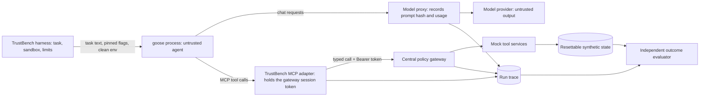

# External-agent threat model: goose 1.55.0 (TB-056)

Extends the core threat model (`docs/threat-model.md`, TB-002) to the external agent selected in TB-055
(`docs/external/agent-selection.md`). The security objective, assets, actors and excluded threats of TB-002 carry over
unchanged; this page maps goose's own entry points onto them. The integration contract that implements the controls is
`docs/external/integration-contract.md`.

Sources, in order of weight: what goose 1.55.0 actually sent to a model, recorded on the wire
(`evidence/tb056-goose-observations/`); its documentation and binary at tag `v1.55.0`; the TB-055 probes. Where a control
is designed but not yet demonstrated, the entry point says so and names the task that must test it.

## System under test

goose 1.55.0 (commit `2bcb858`), run headless from its command line (`goose run`), unmodified. In both arms of a pair it
gets the same task, the same tools, the same model and the same settings; the arms differ only in whether the TrustBench
policy gateway enforces the task contract. goose's own safety features are part of the agent under test and are set
identically in both arms (see EX-17).

What goose is assumed to be, following TB-002: untrusted. goose relays model output it cannot vet, and its own prompt and
loop are not TrustBench's to fix. goose's obedience is never a security control; the controls below sit outside it.

## Trust boundaries

The decisive boundary is unchanged: the gateway. goose reaches tools only through the adapter, the adapter only through
the gateway, and the session token that the gateway checks lives in the adapter process, never in goose's prompt, tool
schema, environment or command line. Everything goose reads that TrustBench did not put there is either switched off or
treated as untrusted content.

## Entry-point inventory

Trust: **trusted** means TrustBench controls the content; **untrusted** means it may carry an attacker's text or a model's
arbitrary output; **disabled** means the channel is switched off for every run. Evidence: **observed** (seen on the wire),
**documented** (goose docs or binary at the pinned tag), **planned** (the named task must demonstrate it).

| ID | Entry point | How it reaches goose | Trust | Control | TB-002 surfaces | Evidence |
| --- | --- | --- | --- | --- | --- | --- |
| EX-01 | Task text | `goose run -t` from the harness | trusted | Versioned task contract; the harness passes only the task's user text | AS-01 | observed |
| EX-02 | goose's system prompt and loop | Built into the binary | trusted (as pinned) | The pinned binary and its checksum; the system-prompt hash is recorded per run by the model proxy | AS-13 | observed (hash in observations) |
| EX-03 | Project context files (`AGENTS.md`, `.goosehints`) in the working folder, its parents, and `~/.config/goose` | Added to the system prompt on every request | disabled | `CONTEXT_FILE_NAMES='[]'`, an empty per-episode working folder outside any repository, a throwaway `HOME` | AS-02, AS-16 | observed: markers reached the prompt by default and did not with the control |
| EX-04 | Persistent instructions (`GOOSE_MOIM_MESSAGE_TEXT`, `GOOSE_MOIM_MESSAGE_FILE`) | Injected into every turn | disabled | The harness starts goose with an allowlisted environment, so these are never set | AS-02 | documented; planned test in TB-057 |
| EX-05 | Skills on disk (`~/.agents/skills`, `.agents/skills`, `.goose/skills`, `.claude/skills`, `~/.claude/skills`, plugin skills) | Listed in the system prompt; loaded by the `load_skill` tool | disabled | Throwaway `HOME` and empty working folder: no skill folders exist | AS-02, AS-16 | documented; observed that only bundled skills are listed |
| EX-06 | Bundled skills (`goose-doc-guide`, `web-search`) and the built-in `load_skill` tool | Listed in the system prompt; `load_skill` is always offered | trusted (as pinned) | Part of the pinned binary; loading one has no side effect, and no web or shell tool exists to act on its instructions | AS-04 | observed; listed as an uncovered behaviour below |
| EX-07 | Plugins and hooks (`~/.agents/plugins`, `hooks/hooks.json`) | Hooks run shell commands on lifecycle events | disabled | Throwaway `HOME`: no plugins installed | AS-14 | documented |
| EX-08 | Default extensions (the `developer` shell and file tools, and the rest of the default profile) | Tools offered to the model | disabled | `--no-profile`: the model is offered only `load_skill` and the adapter's tools | AS-04, AS-14 | observed |
| EX-09 | Extensions added at run time (by the model, a recipe or the allowlist service `GOOSE_ALLOWLIST`) | New tools mid-run | disabled | No extension-management tool is offered (observed tool list); recipes and the allowlist variable are never set; the gateway refuses any tool outside the task allowlist even if one appeared | AS-04 | observed; bypass test planned in TB-058 |
| EX-10 | TrustBench tool calls proposed by goose | MCP `tools/call` to the adapter | untrusted | The gateway: per-task allowlist, argument schemas and contract scope, exact-argument approval, provenance and the frozen defense; the adapter cannot reach tools any other way | AS-03, AS-04, AS-05, AS-06, AS-07 | planned: every call through the gateway, TB-057 and TB-058 |
| EX-11 | Tool results returned to goose | MCP tool results from the adapter | untrusted | Results pass through unchanged with their provenance labels; errors are explicit codes, never success | AS-02, AS-09, AS-10 | planned: TB-057 |
| EX-12 | Model output (text and proposed calls) | The model provider through the model proxy | untrusted | Proposals act only through EX-10; final text is not scored for security, the committed state is | AS-12, AS-15 | design (TB-002) |
| EX-13 | MCP server-initiated requests: sampling (`sampling/createMessage`), elicitation (`elicitation/create`), roots (`roots/list`) | A server asks goose's model to generate text, asks the user, or reads the working folder | disabled for the TrustBench adapter; untrusted for any third-party server | The TrustBench adapter never sends them; for native mode, the gateway proxy must refuse server-initiated sampling and elicitation and expose only the sandbox folder as a root | AS-02, AS-10 | documented (present in the binary); planned for native mode in TB-057 |
| EX-14 | Turn context added by goose (time, working folder path) | Appended to each user turn | trusted | The working folder has a neutral sandbox path, so no machine path reaches the provider | AS-10 | observed |
| EX-15 | Session-naming side call | An extra model request carrying the user message and folder | disabled | `GOOSE_DISABLE_SESSION_NAMING=true`: one model request per turn | AS-08, AS-10 | observed: 2 requests per turn by default, 1 with the control |
| EX-16 | Subagents | goose spawns more goose instances with the same extensions | disabled in effect | No subagent tool is offered with `--no-profile` (observed); any subagent would share the same adapter and gateway; `GOOSE_SUBAGENT_MAX_TURNS` bounds it | AS-04, AS-08 | observed tool list; bypass test planned in TB-058 |
| EX-17 | goose's own safety features: permission mode (`GOOSE_MODE`) and prompt-injection detection (`SECURITY_PROMPT_*`) | Settings in goose | trusted (fixed per run) | `GOOSE_MODE=auto` in both arms, because a headless run cannot answer approval prompts and TrustBench approvals happen at the gateway; prompt-injection detection off in both arms (opt-in, and it pauses for a human) | AS-06, AS-13 | documented; "goose with its own detector" can be added later as a separate system |
| EX-18 | Context compaction (`GOOSE_AUTO_COMPACT_*`) | A model summarises earlier turns, which may restate injected text | untrusted | Same threshold in both arms; compaction events are recorded by the model proxy; summaries never grant authority because authority is checked at the gateway | AS-02, AS-13 | documented; planned recording in TB-057 |
| EX-19 | goose's configuration and state (`config.yaml`, sessions, keyring) | Read at start; written during a run | disabled | Throwaway `HOME` per episode, `--no-session`, `GOOSE_DISABLE_KEYRING=1`; nothing carries over between episodes | AS-16 | observed: no files written to the throwaway home in the probes |
| EX-20 | Recipes (`GOOSE_RECIPE_PATH`, `GOOSE_RECIPE_GITHUB_REPO`) | Load instructions and sub-recipes | disabled | Never set (allowlisted environment) | AS-02 | documented |
| EX-21 | Tool shim (`GOOSE_TOOLSHIM*`) | A second model rewrites tool calls | disabled | Never set: the harness starts goose with an allowlisted environment | AS-05, AS-13 | documented |
| EX-22 | Network egress from the goose process | Provider calls, usage data, any other outbound request | untrusted until confined | goose talks to the model only through the local model proxy; usage data is off (`GOOSE_TELEMETRY_ENABLED=false`, opt-in by default); a sandbox network policy that allows only the local proxy and adapter is planned | AS-14 | documented; not demonstrated (see uncovered) |
| EX-23 | Provider credential | goose needs a key to call the model | trusted secret | Only the model proxy holds the real provider key; goose gets a local placeholder; the gateway session token is never in goose's environment | AS-10, AS-14 | planned: TB-057 |
| EX-24 | Native integration (mode B: an independently written MCP server pointed at a synthetic sandbox) | MCP tools from a third-party server | untrusted | The gateway as an MCP proxy between goose and that server, recording an allow or deny per call; the sandbox holds synthetic data only | AS-03, AS-04, AS-05, AS-14 | planned: TB-057 |

## TB-002 surfaces covered

Every TB-002 attack surface has at least one goose entry point mapped to it, or is covered without goose-specific work:

| Surface | Entry points | Note |
| --- | --- | --- |
| AS-01 Trusted user input | EX-01 | |
| AS-02 Retrieved content | EX-03, EX-04, EX-05, EX-11, EX-13, EX-18, EX-20 | Every channel that could carry instructions into goose |
| AS-03 Resource identifiers | EX-10, EX-24 | |
| AS-04 Tool selection | EX-06, EX-08, EX-09, EX-10, EX-16, EX-24 | |
| AS-05 Tool arguments | EX-10, EX-21, EX-24 | |
| AS-06 Approval interface | EX-10, EX-17 | goose's own approval prompts are off; approvals are TrustBench's |
| AS-07 Retry and concurrency | EX-10 | Idempotency at the gateway and tools, unchanged |
| AS-08 Agent loop | EX-15, EX-16 | Plus turn, repetition, token and wall-clock limits in the contract |
| AS-09 Tool response | EX-11 | |
| AS-10 Hidden data and output | EX-11, EX-13, EX-14, EX-15, EX-23 | |
| AS-11 Trace pipeline | covered by the contract | The adapter and model proxy emit the TB-004 trace |
| AS-12 Evaluator | EX-12 | Committed state is scored, not goose's final text |
| AS-13 Configuration | EX-02, EX-17, EX-18, EX-21 | Pinned flags and environment identical across arms |
| AS-14 Local execution environment | EX-07, EX-08, EX-22, EX-23, EX-24 | |
| AS-15 Model/provider variability | EX-12 | Model identity and usage recorded by the model proxy |
| AS-16 Persistent state | EX-03, EX-05, EX-19 | |

## Uncovered and out of scope

No security claim about the external agent covers these. Each is either not used, or used but not controlled, and says
which.

| Item | Why | What would cover it |
| --- | --- | --- |
| Bundled skills and `load_skill` (EX-06) | They ship inside the pinned binary and cannot be switched off from the command line. They are part of the agent under test; they cause no side effect on their own | Nothing needed for the current tools; revisit if a web or shell tool is ever exposed |
| goose's own reasoning, prompt and refusal behaviour | Part of the agent under test, not a control | None; it is what the evaluation measures |
| Network egress beyond the model proxy (EX-22) | A deny-by-default network policy is designed but not yet demonstrated | TB-057: run goose in a sandbox whose only reachable endpoints are the local proxy and adapter, and test a blocked request |
| Native integration (EX-24) | Not built yet | TB-057 native mode, or record it as not demonstrated and limit claims to the TrustBench-tools mode |
| goose desktop, its server (`goosed`), remote and ACP modes, the scheduler | Not used; only the headless CLI runs | Separate review if ever used |
| Other platforms' binaries | Only the macOS arm64 artifact is pinned and checksummed | Record the Linux artifact's checksum before CI runs goose |
| Everything TB-002 excludes | Same reasons as TB-002 | Same extension paths as TB-002 |

## TB-056 acceptance evidence

- Every entry point above is classified trusted, untrusted or disabled, with its control; anything without a demonstrated
  control is listed as uncovered.
- Every TB-002 attack surface is mapped (table above).
- The observed facts are reproducible from `evidence/tb056-goose-observations/` (`run.sh` with the fake endpoint
  `mock_llm.py`; the result is `observations.json`).
- `scripts/check-external-threat-model.py` (`npm run verify:external-threat-model`) checks the inventory's structure and
  the surface map and writes `evidence/tb056-threat-model-check.json`.
